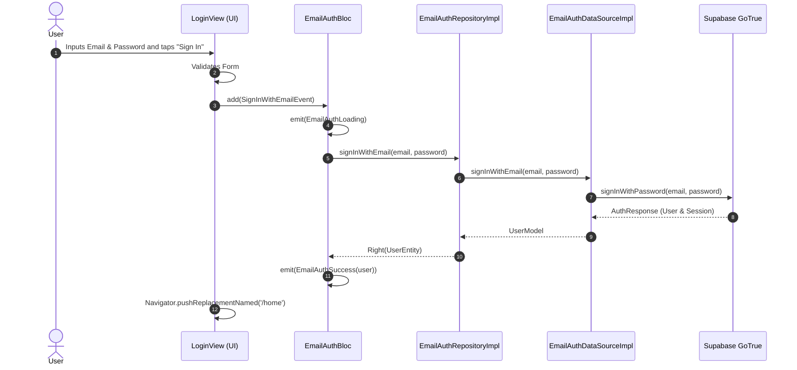
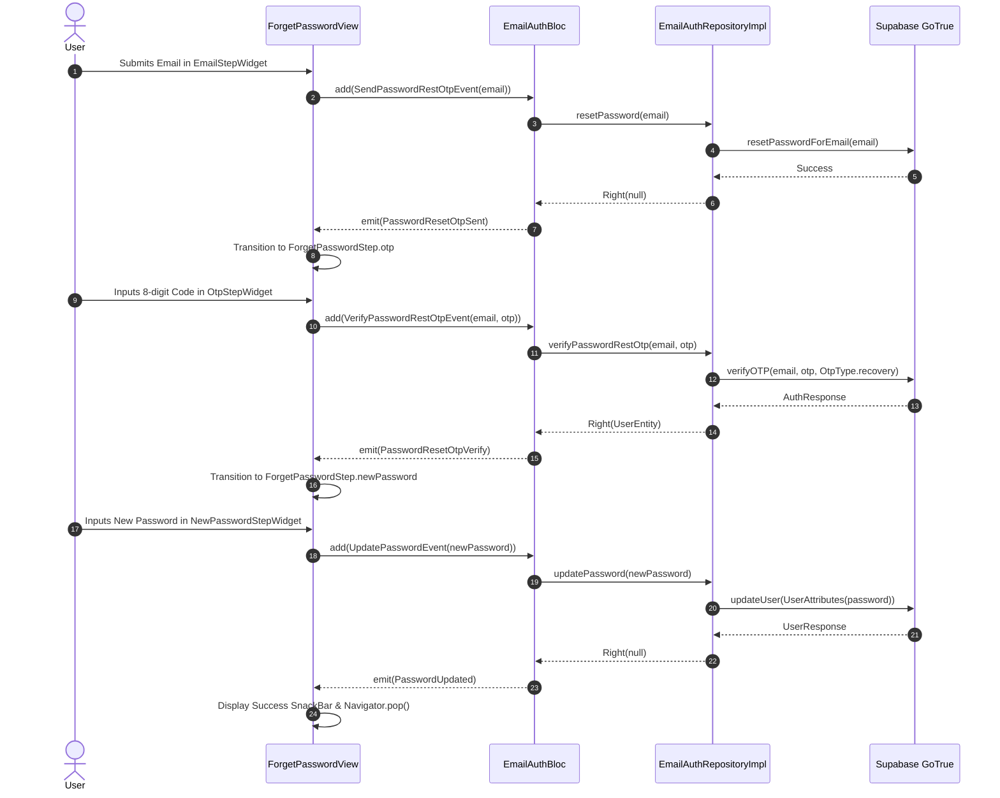
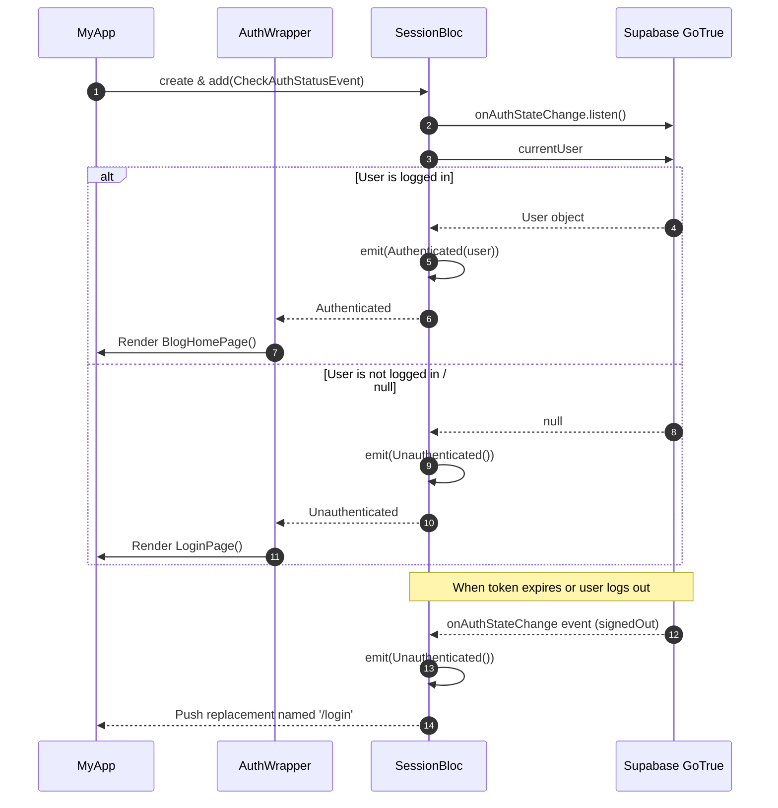

# Authentication Feature Module (`lib/features/auth`)

Comprehensive documentation for the Authentication feature in the **Blog Supabase** Flutter application.

---

## Table of Contents
1. [Overview & Architecture](#1-overview--architecture)
2. [Folder & File Structure](#2-folder--file-structure)
3. [Domain Layer](#3-domain-layer)
   - [User Entity](#user-entity)
   - [Repository Interfaces](#repository-interfaces)
4. [Data Layer](#4-data-layer)
   - [User Model](#user-model)
   - [Data Sources](#data-sources)
   - [Repository Implementations](#repository-implementations)
5. [Presentation Layer](#5-presentation-layer)
   - [Bloc Architecture & State Management](#bloc-architecture--state-management)
   - [Screens & Navigation](#screens--navigation)
   - [Reusable Components](#reusable-components)
6. [Architectural Workflows & Sequence Diagrams](#6-architectural-workflows--sequence-diagrams)
   - [Email & Password Authentication](#email--password-authentication)
   - [Three-Step Password Reset Flow](#three-step-password-reset-flow)
   - [Session Management & Route Guarding](#session-management--route-guarding)
7. [Dependency Injection Configuration](#7-dependency-injection-configuration)
8. [Backend & Supabase Integration](#8-backend--supabase-integration)
9. [Error Handling Strategy](#9-error-handling-strategy)

---

## 1. Overview & Architecture

The `auth` feature handles all aspects of user identity, session lifecycle, credential authentication, social login, multi-step password recovery, phone OTP verification, and user profile operations (including avatar upload and account deletion).

It strictly follows **Clean Architecture** with a unidirectional data flow and clean boundary separation:

```
┌────────────────────────────────────────────────────────┐
│                   PRESENTATION LAYER                   │
│   Screens (Login, Signup, PhoneAuth, Profile, etc.)    │
│   Blocs (EmailAuth, PhoneAuth, Social, Profile, Session)│
└───────────────────────────┬────────────────────────────┘
                            │ depends on
┌───────────────────────────▼────────────────────────────┐
│                      DOMAIN LAYER                      │
│   Entities (UserEntity)                                │
│   Repository Interfaces (EmailAuth, Session, etc.)     │
└───────────────────────────▲────────────────────────────┘
                            │ implemented by
┌───────────────────────────┴────────────────────────────┐
│                       DATA LAYER                       │
│   Models (UserModel extending UserEntity)              │
│   Repository Implementations                           │
│   Data Sources (Direct interface to AuthClient)        │
└───────────────────────────┬────────────────────────────┘
                            │ delegates to
┌───────────────────────────▼────────────────────────────┐
│                    CORE / NETWORK                      │
│   AuthClient (Supabase GoTrue & Edge Functions)        │
│   StorageClient (Supabase Storage 'avatars' bucket)    │
└────────────────────────────────────────────────────────┘
```

### Core Technologies
- **State Management:** `flutter_bloc` (Bloc pattern) + `equatable`
- **Backend:** `supabase_flutter` (GoTrue Auth, Realtime session stream, Storage, Edge Functions)
- **Dependency Injection:** `get_it` service locator
- **Functional Error Handling:** `dartz` (`Either<Failure, T>`)
- **OAuth & Auth Tools:** `google_sign_in`, `pinput` (PIN/OTP input), `image_picker` (Avatar selection)

---

## 2. Folder & File Structure

```
lib/features/auth/
├── data/
│   ├── datasources/
│   │   ├── email_auth_datasource.dart          # Contract for email/password operations
│   │   ├── email_auth_datasource_impl.dart     # Supabase GoTrue email implementation
│   │   ├── phone_auth_datasource.dart          # Contract for SMS OTP auth
│   │   ├── phone_auth_datasource_impl.dart     # Supabase GoTrue phone OTP implementation
│   │   ├── profile_datasource.dart             # Contract for profile & avatar mutations
│   │   ├── profile_datasource_impl.dart        # Supabase Storage + GoTrue user update
│   │   ├── session_datasource.dart             # Contract for session state & auth stream
│   │   ├── session_datasource_impl.dart        # Current user & authStateChanges stream
│   │   ├── social_auth_datasource.dart         # Contract for OAuth providers
│   │   └── social_auth_datasource_impl.dart    # Google (idToken) & GitHub (OAuth)
│   ├── models/
│   │   └── user_model.dart                     # UserEntity extension with JSON & Supabase serialization
│   └── repositories/
│       ├── email_auth_repository_impl.dart     # Translates datasource exceptions into Failures
│       ├── phone_auth_repository_impl.dart     # Phone auth failure-catching repository
│       ├── profile_repository_impl.dart        # Profile operations repository
│       ├── session_repository_impl.dart        # Session state repository
│       └── social_auth_repository_impl.dart    # Social logins repository
├── domain/
│   ├── entities/
│   │   └── user_entity.dart                    # Pure business representation of a user
│   └── repositories/
│       ├── email_auth_repository.dart          # Domain contract for email actions
│       ├── phone_auth_repository.dart          # Domain contract for phone OTP
│       ├── profile_repository.dart             # Domain contract for profile management
│       ├── session_repository.dart             # Domain contract for session tracking
│       └── social_auth_repository.dart         # Domain contract for OAuth actions
└── presentation/
    ├── bloc/
    │   ├── email_auth/
    │   │   ├── email_auth_bloc.dart            # Handles signup, signin, reset password, magic link
    │   │   ├── email_auth_event.dart           # Email auth UI events
    │   │   └── email_auth_state.dart           # Email auth states (Loading, Success, Error, etc.)
    │   ├── phone_auth/
    │   │   ├── phone_auth_bloc.dart            # Handles sending and verifying SMS OTP
    │   │   ├── phone_auth_event.dart           # Phone auth UI events
    │   │   └── phone_auth_state.dart           # Phone auth states (OTPSent, Success, Error)
    │   ├── profile/
    │   │   ├── profile_bloc.dart               # Handles profile updates, avatar upload, delete
    │   │   ├── profile_event.dart              # Profile UI events
    │   │   └── profile_state.dart              # Profile states
    │   ├── session/
    │   │   ├── session_bloc.dart               # App-level auth state (Authenticated/Unauthenticated)
    │   │   ├── session_event.dart              # Session check, sign-out, stream changes
    │   │   └── session_state.dart              # Authenticated, Unauthenticated, SessionLoading
    │   └── social_auth/
    │       ├── social_auth_bloc.dart           # Handles Google, GitHub, Apple OAuth
    │       ├── social_auth_event.dart          # Social auth triggers
    │       └── social_auth_state.dart          # Social auth states
    └── screens/
        ├── components/
        │   └── forget_password/
        │       ├── email_step_widget.dart      # Step 1: Input email & trigger reset code
        │       ├── otp_step_widget.dart        # Step 2: Input 8-digit OTP with Pinput
        │       └── new_password_step_widget.dart # Step 3: Input new password & confirmation
        ├── forget_password_screen.dart         # 3-step password recovery wizard
        ├── login_screen.dart                   # Sign-in UI (email/password, social logins)
        ├── phone_auth_screen.dart              # Phone number & SMS OTP screen
        ├── profile_screen.dart                 # User profile display, avatar upload, sign out/delete
        └── signup_screen.dart                  # User registration screen
```

---

## 3. Domain Layer

The Domain layer is completely independent of external packages, frameworks, and data sources (relying only on `dartz` and `equatable`).

### User Entity
File: `lib/features/auth/domain/entities/user_entity.dart`

```dart
class UserEntity extends Equatable {
  final String id;
  final String email;
  final String? displayName;
  final String? photoUrl;
  final String? phoneNumber;
  final bool isEmailVerified;
  final DateTime createdAt;
  ...
}
```

- **Immutability:** Extends `Equatable` for value comparison based on its attributes.
- **Attributes:** Identifies the user uniquely via Supabase UUID `id`, storing credentials, verification status, contact details, and account creation timestamp.

### Repository Interfaces
The domain layer defines 5 abstract repository contracts:

| Repository Interface | Methods | Description |
| :--- | :--- | :--- |
| `EmailAuthRepository` | `signUpWithEmail(...)`<br>`signInWithEmail(...)`<br>`resetPassword(...)`<br>`verifyPasswordRestOtp(...)`<br>`updatePassword(...)`<br>`sendMagicLink(...)` | Full email/password lifecycle, recovery, OTP verification, and password updates. Returns `Either<Failure, UserEntity>` or `Either<Failure, void>`. |
| `PhoneAuthRepository` | `sendOTP({required phoneNumber})`<br>`verifyOTP({required phoneNumber, required otpCode})` | Initiates SMS OTP delivery and validates the code, returning authenticated `UserEntity`. |
| `SocialAuthRepository` | `signInWithGoogle()`<br>`signInWithApple()`<br>`signInWithGitHub()` | Authenticates via third-party OAuth providers. |
| `ProfileRepository` | `updateProfile({name, avatarUrl})`<br>`uploadProfilePicture({required filePath})`<br>`deleteAccount()` | Updates profile metadata, uploads image to storage, or invokes account deletion. |
| `SessionRepository` | `getCurrentUser()`<br>`signOut()`<br>`Stream<UserEntity?> get authStateChanges` | Queries active session user, terminates session, and exposes a real-time reactive auth stream. |

---

## 4. Data Layer

The Data layer implements domain contracts, handles serialization, and directly interacts with the core networking clients.

### User Model
File: `lib/features/auth/data/models/user_model.dart`

`UserModel` extends `UserEntity` and provides constructors for data transformation:
- `UserModel.fromSupabaseUser(User user)`: Converts a `supabase_flutter.User` instance into a domain model. Maps `user.userMetadata['name']` to `displayName`, and `userMetadata['avatar_url']` / `userMetadata['photo']` to `photoUrl`.
- `UserModel.fromJson(Map<String, dynamic> json)`: Deserializes database / API JSON maps into `UserModel`.
- `toJson()`: Serializes `UserModel` into a Postgres/JSON-compatible map.
- `copyWith(...)`: Facilitates immutable object copying with overridden attributes.

### Data Sources
Data sources interact with the low-level `AuthClient` (`lib/core/network/supabase/auth_client.dart`) and `StorageClient`:

1. **`EmailAuthDataSourceImpl`**:
   - `signUpWithEmail`: Calls `AuthClient.signUp` with name attached to metadata. Throws `AuthException` if user is null.
   - `signInWithEmail`: Calls `AuthClient.signIn(email, password)`.
   - `resetPassword`: Calls `AuthClient.resetPasswordForEmail(email)`.
   - `verifyPasswordRestOtp`: Verifies recovery token via `AuthClient.verifyPasswordResetOtp(email, otp)`.
   - `updatePassword`: Calls `AuthClient.updatePassword(password)`.
   - `sendMagicLink`: Calls OTP sign-in.

2. **`PhoneAuthDataSourceImpl`**:
   - `sendOTP`: Calls `AuthClient.signInWithOtp(phoneNumber)`.
   - `verifyOTP`: Calls `AuthClient.verifyOtp(phoneNumber, otpCode)` with `OtpType.sms`.

3. **`SocialAuthDataSourceImpl`**:
   - `signInWithGoogle`: Uses Google Sign-In SDK (`GoogleSignIn.instance.authenticate()`) with `GOOGLE_WEB_CLIENT_ID`, retrieves the Google `idToken`, and forwards it to Supabase via `AuthClient.signInWithIdToken(OAuthProvider.google, idToken)`.
   - `signInWithGitHub`: Uses `AuthClient.signInWithOAuth(OAuthProvider.github, 'com.elgendy.authflowapp://login-callback')` to launch external browser OAuth.
   - `signInWithApple`: Placeholder for Apple Sign-In integration.

4. **`ProfileDataSourceImpl`**:
   - `uploadProfilePicture`: Reads local file bytes, determines file extension, uploads to `'avatars'` bucket at `$userId/avatar.$extension`, retrieves public URL, and calls `updateUser(avatarUrl: publicUrl)`.
   - `updateProfile`: Updates user metadata (`name`, `avatarUrl`) via `AuthClient.updateUser`.
   - `deleteAccount`: Calls Supabase Edge Function `'delete-account'` and performs a global sign out.

5. **`SessionDataSourceImpl`**:
   - `getCurrentUser`: Returns the active user from GoTrue cache mapped to `UserModel`.
   - `signOut`: Global sign-out terminating the refresh token.
   - `authStateChanges`: Subscribes to `AuthClient.onAuthStateChange` and maps session changes into a `Stream<UserModel?>`.

### Repository Implementations
Each repository implementation (`*RepositoryImpl`) wraps datasource calls in `try / catch` blocks to ensure no raw exceptions bubble up to the presentation layer:
- Catches `AuthException` -> returns `Left(AuthFailure(e.message))`
- Catches `ServerException` -> returns `Left(ServerFailure(e.message))`
- Catches generic `Exception` -> returns `Left(ServerFailure('Unexpected error: ...'))`
- On success -> returns `Right(result)`

---

## 5. Presentation Layer

The presentation layer is powered by **Flutter Bloc** and organizes state by business capability.

### Bloc Architecture & State Management

```
                    ┌────────────────────────────┐
                    │        SessionBloc         │
                    │  (App Root / Auth Guard)   │
                    └──────────────┬─────────────┘
                                   │ listens to
                                   ▼
                    ┌────────────────────────────┐
                    │     authStateChanges       │
                    └────────────────────────────┘

┌─────────────────┐ ┌─────────────────┐ ┌─────────────────┐ ┌─────────────────┐
│  EmailAuthBloc  │ │  PhoneAuthBloc  │ │ SocialAuthBloc  │ │   ProfileBloc   │
│  (Auth & Reset) │ │   (Phone OTP)   │ │  (Google/OAuth) │ │(Avatar/Account) │
└─────────────────┘ └─────────────────┘ └─────────────────┘ └─────────────────┘
```

#### 1. `EmailAuthBloc`
- **Events:**
  - `SignUpWithEmailEvent(email, password, name)`
  - `SignInWithEmailEvent(email, password)`
  - `SendPasswordRestOtpEvent(email)`
  - `VerifyPasswordRestOtpEvent(email, otp)`
  - `UpdatePasswordEvent(password)`
  - `SendMagicLinkEvent(email)`
- **States:**
  - `EmailAuthInitial`
  - `EmailAuthLoading`
  - `EmailAuthSuccess(UserEntity user)`
  - `EmailAuthError(String message)`
  - `PasswordResetOtpSent(String message)`
  - `PasswordResetOtpVerify`
  - `PasswordUpdated`

#### 2. `PhoneAuthBloc`
- **Events:**
  - `SendOTPEvent(phoneNumber)`
  - `VerifyOTPEvent(phoneNumber, otpCode)`
- **States:**
  - `PhoneAuthInitial`
  - `PhoneAuthLoading`
  - `OTPSent`
  - `PhoneAuthSuccess(UserEntity user)`
  - `PhoneAuthError(String message)`

#### 3. `SocialAuthBloc`
- **Events:**
  - `SignInWithGoogleEvent()`
  - `SignInWithAppleEvent()`
  - `SignInWithGitHubEvent()`
- **States:**
  - `SocialAuthInitial`
  - `SocialAuthLoading`
  - `SocialAuthSuccess(UserEntity user)`
  - `SocialAuthError(String message)`
  - `SocialAuthLaunched`

#### 4. `ProfileBloc`
- **Events:**
  - `UpdateProfileEvent(name, avatarUrl)`
  - `UploadProfilePictureEvent(filePath)`
  - `DeleteAccountEvent()`
- **States:**
  - `ProfileInitial`
  - `ProfileLoading`
  - `ProfileUpdated(UserEntity user)`
  - `ProfilePictureUploaded(String url)`
  - `AccountDeleted`
  - `ProfileError(String message)`

#### 5. `SessionBloc`
- **Scope:** Root level (`MaterialApp`), persists across all routes.
- **Events:**
  - `CheckAuthStatusEvent()`: Triggered at application startup.
  - `SignOutEvent()`: Terminates current session.
  - `AuthStateChangedEvent(UserEntity? user)`: Internal event triggered when `authStateChanges` fires.
- **States:**
  - `SessionInitial`
  - `SessionLoading`
  - `Authenticated(UserEntity user)`
  - `Unauthenticated`
  - `SessionError(String message)`

---

### Screens & Navigation

All auth screens are registered in `lib/main.dart` under named routes:

| Screen | Route | Bloc Provided | Purpose & Behavior |
| :--- | :--- | :--- | :--- |
| `LoginPage` | `/login` | `EmailAuthBloc`, `SocialAuthBloc` | Main authentication entry point. Validates credentials, offers Google and GitHub OAuth options, redirects to `/home` on success. |
| `SignupPage` | `/signup` | `EmailAuthBloc` | Registration with full name, email, password, and password confirmation validation. Redirects to `/home` on success. |
| `PhoneAuthPage` | `/phone-auth` | `PhoneAuthBloc` | 2-step phone verification (Phone number input -> 8-digit OTP entry with `Pinput`). Redirects to `/home` on success. |
| `ForgetPasswordPage`| `/forgot-password` | `EmailAuthBloc` | 3-step stateful wizard screen managing password reset flow without changing screens. |
| `ProfilePage` | `/profile` | `ProfileBloc` | Shows current user data, handles avatar pick & upload, account deletion confirmation dialog, and sign out. |

---

### Reusable Components

Located in `lib/features/auth/presentation/screens/components/forget_password/`:

1. **`EmailStepWidget`**:
   - Renders email field with validation regex.
   - Dispatches `SendPasswordRestOtpEvent`.
2. **`OtpStepWidget`**:
   - Utilizes `Pinput` package configured for 8-digit verification codes.
   - Automatically invokes verification on code completion.
   - Includes a "Resend Code" trigger button.
3. **`NewPasswordStepWidget`**:
   - Provides new password and password confirmation inputs.
   - Validates min 6-character length and equality.
   - Dispatches `UpdatePasswordEvent`.

---

## 6. Architectural Workflows & Sequence Diagrams

### Email & Password Authentication



### Three-Step Password Reset Flow



### Session Management & Route Guarding



---

## 7. Dependency Injection Configuration

All feature classes are registered using `get_it` in `lib/core/di/injection_container.dart`:

```dart
// 1. DataSources (Lazy Singletons)
sl.registerLazySingleton<EmailAuthDataSource>(() => EmailAuthDataSourceImpl(sl()));
sl.registerLazySingleton<SocialAuthDataSource>(() => SocialAuthDataSourceImpl(sl()));
sl.registerLazySingleton<PhoneAuthDataSource>(() => PhoneAuthDataSourceImpl(sl()));
sl.registerLazySingleton<SessionDataSource>(() => SessionDataSourceImpl(sl()));
sl.registerLazySingleton<ProfileDataSource>(() => ProfileDataSourceImpl(sl(), sl()));

// 2. Repositories (Lazy Singletons)
sl.registerLazySingleton<EmailAuthRepository>(
  () => EmailAuthRepositoryImpl(emailAuthDataSource: sl()),
);
sl.registerLazySingleton<SocialAuthRepository>(
  () => SocialAuthRepositoryImpl(socialAuthDataSource: sl()),
);
sl.registerLazySingleton<PhoneAuthRepository>(
  () => PhoneAuthRepositoryImpl(phoneAuthDataSource: sl()),
);
sl.registerLazySingleton<SessionRepository>(
  () => SessionRepositoryImpl(sessionDataSource: sl()),
);
sl.registerLazySingleton<ProfileRepository>(
  () => ProfileRepositoryImpl(profileDataSource: sl()),
);

// 3. Blocs (Factories for screen-scoped, Lazy Singleton for session)
sl.registerFactory(() => EmailAuthBloc(emailAuthRepository: sl()));
sl.registerFactory(() => SocialAuthBloc(socialAuthRepository: sl()));
sl.registerFactory(() => PhoneAuthBloc(phoneAuthRepository: sl()));
sl.registerFactory(() => ProfileBloc(profileRepository: sl()));
sl.registerLazySingleton(() => SessionBloc(sessionRepository: sl()));
```

> [!NOTE]
> `SessionBloc` is registered as a **Lazy Singleton** because its lifecycle matches the application process, preserving session state globally. Screen-specific Blocs (`EmailAuthBloc`, `SocialAuthBloc`, `ProfileBloc`, `PhoneAuthBloc`) are registered as **Factories** to allow new instances per screen navigation.

---

## 8. Backend & Supabase Integration

### Supabase Requirements
1. **Authentication Providers:**
   - **Email:** Enable "Confirm email" if verification is enforced, or disable for instant access during testing.
   - **Google:** Configure Web Client ID in Supabase Auth Settings and pass via `--dart-define=GOOGLE_WEB_CLIENT_ID=...`.
   - **GitHub:** Client ID & Client Secret configured with redirect URL `com.elgendy.authflowapp://login-callback`.
   - **Phone (SMS):** Twilio / MessageBird provider activated in Supabase console for SMS OTP.

2. **Storage Bucket (`avatars`):**
   - Bucket Name: `avatars`
   - Public: Yes (or secured with public read RLS).
   - Recommended Storage Policy:
     ```sql
     -- Allow authenticated users to upload to their own folder:
     CREATE POLICY "Users can upload their own avatar"
     ON storage.objects FOR INSERT TO authenticated
     WITH CHECK (bucket_id = 'avatars' AND (storage.foldername(name))[1] = auth.uid()::text);

     -- Allow public read access to avatars:
     CREATE POLICY "Public avatar access"
     ON storage.objects FOR SELECT TO public
     USING (bucket_id = 'avatars');
     ```

3. **Supabase Edge Function (`delete-account`):**
   - Invoked by `ProfileDataSourceImpl.deleteAccount()` via `Supabase.instance.client.functions.invoke('delete-account')`.
   - Runs with Supabase `service_role` key on the server to securely delete the calling user's account from `auth.users`.

4. **Deep Linking Scheme:**
   - iOS: `CFBundleURLSchemes` set to `com.elgendy.authflowapp`
   - Android: `intent-filter` configured with scheme `com.elgendy.authflowapp` and host `login-callback`

---

## 9. Error Handling Strategy

Errors are propagated from the bottom up using functional `dartz.Either`:

```
Supabase GoTrue Exception
      │
      ▼ caught & re-thrown as
Custom Data Exception (e.g. AuthException, ServerException in exceptions.dart)
      │
      ▼ caught & converted in Repository
Domain Failure (AuthFailure, ServerFailure in failures.dart) wrapped in Left(Failure)
      │
      ▼ folded in Bloc
Bloc State (EmailAuthError(message), ProfileError(message), etc.)
      │
      ▼ listened in UI
SnackBar / Alert Dialog display to user
```

### Failure Types in Auth (`lib/core/error/failures.dart`)
- **`AuthFailure`**: Returned for invalid credentials, user not found, expired OTP, email already in use, or unauthorized actions.
- **`ServerFailure`**: Returned when network timeouts, 5xx server issues, or unexpected platform errors occur.
